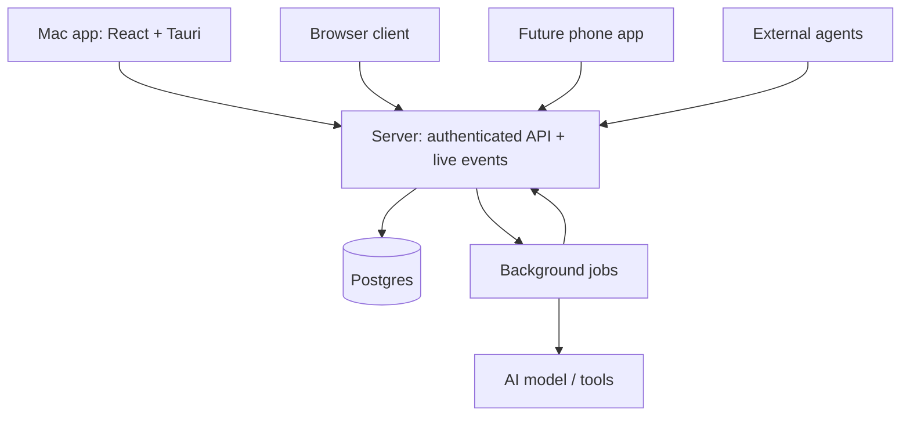

**Yes. We can park the phone client and build an API-first system with a central server.** Mac, browser, future phone clients, and agents would all use the same API.

And you’re right about Tauri: **Tauri 2 supports iOS and Android builds**, alongside desktop. My earlier recommendation added Capacitor without establishing a need for it. We can use Tauri as our intended application shell across platforms, validating mobile-specific capabilities when we reach that stage. [Tauri distribution documentation](https://v2.tauri.app/distribute/)

**Where everything runs**

The Tauri app contains the interface and local device integrations. **The shared server owns accounts, permissions, message storage, routing, and agent execution.** Closing the Mac app does not stop an agent’s work.

**Discovery happens through the server**

There are a few different meanings of discovery:

| What needs discovering | How it works                                                      |
| ---------------------- | ----------------------------------------------------------------- |
| Server                 | The app knows a configured API URL; DNS resolves it               |
| Workspace              | Create one or accept an invitation                                |
| Teammates              | Search the workspace member directory                             |
| Channels               | Server lists channels the user can discover or access             |
| Agents                 | Workspace directory lists available agents and their capabilities |
| Online users           | Temporary presence state maintained through live connections      |

For the first version, workspace invitations are sufficient. We don’t need nearby-device discovery, peer-to-peer networking, or a public user directory.

A conversation has a permanent ID. Clients send messages to that ID; they don’t need to know another user’s device address.

**How message routing works**

Suppose Alice sends a message to `#engineering`:

1. Her client immediately displays it as **sending**, with a unique client-generated ID.
2. It calls `POST /v1/conversations/{id}/messages`.
3. The server verifies Alice’s identity and conversation membership.
4. In one database transaction, it stores the message and records the work needed to publish it.
5. The server acknowledges the saved message and broadcasts an event to authorized connected clients.
6. Those clients merge it into their local conversation using the message ID.
7. Offline users retrieve it when they return. Later, push notifications can alert their phones.

**Stored successfully and received by a device are different states.** We should make that distinction explicit rather than claiming delivery when only the database write has succeeded.

A DM uses the same routing mechanism as a channel, with a restricted membership list.

**What happens after a disconnect**

Live events make the interface responsive; the database remains authoritative.

Each client keeps a synchronization cursor. After reconnecting, it asks for changes since that cursor, including message edits and deletions. If its cursor is too old, it fetches a fresh snapshot.

Retries reuse the original client-generated message ID, so a network timeout doesn’t create duplicate messages. We’ll design the reconnect flow to avoid gaps between fetching missed changes and resuming live events.

This also lets a future phone client pick up the same conversations without changing the server architecture.

**Agents use the same system**

An agent gets its own identity and scoped access. When mentioned:

- The server schedules a durable agent run.
- The worker retrieves permitted context and calls the model.
- Its answer is saved through the same message service as a human message.
- Clients receive the normal message event.

An agent can also advertise narrow capabilities such as “summarize this thread” or “create an issue.” External agents later authenticate through scoped credentials and use our API. Internal workers never need unrestricted conversation access.

**The architecture I’d commit to now**

| Component                     | Choice                                     |
| ----------------------------- | ------------------------------------------ |
| Mac app and browser interface | React + TypeScript + Vite                  |
| Application shell             | Tauri 2                                    |
| Product API                   | Node.js + TypeScript + Hono                |
| Durable storage               | Postgres                                   |
| Supporting managed services   | Supabase Auth + Storage                    |
| Live event delivery           | Supabase Realtime private channels         |
| Background work               | pg-boss                                    |
| API contract                  | Versioned HTTP API documented with OpenAPI |

All product mutations go through our server API. Realtime subscriptions must enforce conversation membership, including access revocation. Using managed realtime delivery still fits the central-server design; it is the delivery layer behind our product rules.

Our next milestone becomes **two clients—Mac and browser—exchanging persistent messages through the server, recovering after a disconnect, and receiving an agent response**. Phone development can wait; the API and client boundaries will already support it.
